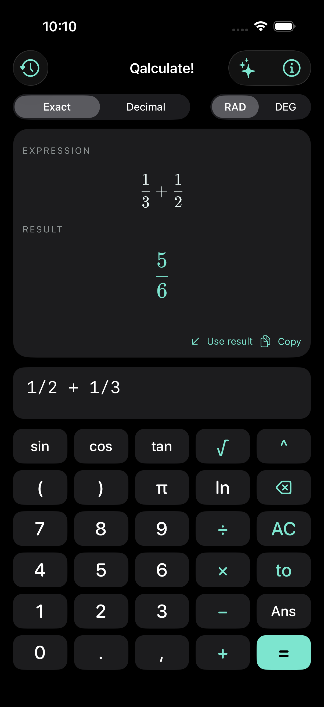
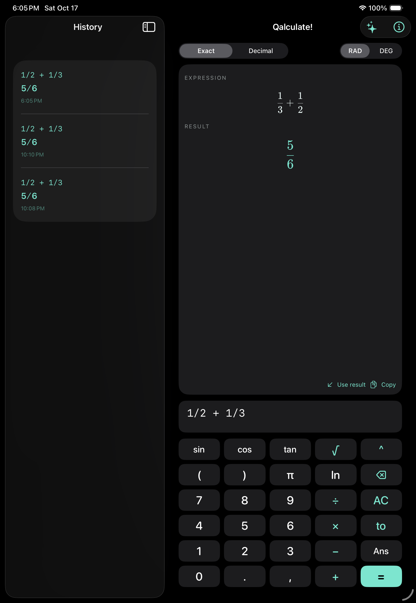

# Qalculate! for iPhone and iPad

A working native SwiftUI port powered by **libqalculate 5.13.1**, not a JavaScript
replacement for the calculation engine. This is an independent, unofficial port.

## Included

- Real Qalculate scientific and symbolic calculations, unit conversion, calculus,
  matrices, complex numbers, and built-in functions and constants.
- Exact fractions or decimal results; radians and degrees; 30-digit precision.
- Textbook-style stacked fractions, powers, roots, and equations using the
  engine's LaTeX output and locally bundled KaTeX.
- Native cursor-aware expression editing and a scientific keypad.
- iPhone interface and an iPad history sidebar; portrait and landscape support.
- Dark mode by default, with Light and System options in About.
- Persistent local history (last 100 calculations), recall, copy, and swipe-delete.
- All calculation and math rendering run offline, without a service or API key.

Type expressions in ordinary notation and tap **=** or Return. The interpreted
expression and result are typeset after calculation. Examples:

```text
1/2 + 1/3
5 ft + 3 in to cm
solve(x^2 = 9, x)
diff(x^3, x)
sqrt(-1)
```

## Open and run on this Mac

Open `Qalculate.xcodeproj`, select the **Qalculate** scheme and an iPhone or iPad
simulator, and press Run. The dependency libraries have already been built in
`Vendor/Engine` locally. These generated libraries are intentionally not in Git.

## Build from a fresh clone

Requirements: an Apple Silicon Mac, full Xcode, its iOS SDK and Simulator
runtime, Homebrew `xcodegen` and `pkgconf`, Python 3, and internet access for the
first dependency build. iOS/iPadOS 17 or newer is the deployment target.

```sh
brew install xcodegen pkgconf
Scripts/build-app.sh
open Qalculate.xcodeproj
```

The build script verifies pinned SHA-256 hashes, then compiles GMP 6.3.0, MPFR
4.2.2, and libqalculate separately for arm64 iOS and arm64 Simulator. It uses the
iOS SDK's libxml2 and iconv, not Homebrew's macOS libraries. Shell execution,
external plotting, built-in network fetching, and gettext are disabled. The
English definition XML and math renderer are bundled in the app.

The checked-in Xcode project is generated from `project.yml`. After adding files
or changing project settings, run `xcodegen generate` again. `Scripts/vendor-math.sh`
refreshes the pinned KaTeX assets with a SHA-512 integrity check.

## Tests

```sh
xcodebuild -project Qalculate.xcodeproj -scheme Qalculate \
  -destination 'platform=iOS Simulator,name=iPhone 17 Pro' \
  -derivedDataPath .build/DerivedData CODE_SIGNING_ALLOWED=NO test
```

Replace the destination with an installed iPad simulator to test the tablet
interface. Tests cover the actual native engine, fraction typesetting, units,
calculus, degree mode, complex numbers, input limits, selection editing, Unicode
backspace, history persistence, visible equation rendering, and landscape controls.

A manual GitHub Actions workflow builds unsigned device and Simulator apps.
Local test results and build logs live under `.build/` and are not committed.

## Install on your own iPhone or iPad

The device build compiles successfully without signing. To install it:

1. Open the Xcode project and select the **Qalculate** target.
2. In **Signing & Capabilities**, choose your Apple development team. Use a
   different bundle identifier if your team requires one.
3. Connect your device, select it as the run destination, and press Run.

This repository does not include signing credentials, provisioning profiles, or
an App Store/TestFlight release. Publication is a separate distribution step.

## Current limits

This is a functional first native release, not complete desktop UI parity.
Graph plotting, live currency exchange-rate updates, custom-definition editors
and persistence, RPN mode, and desktop import/export workflows are not yet ported.
Only the English engine definitions and arm64 platforms are currently packaged.
Expressions are limited to 4096 characters and evaluations to 3 seconds; printing
also has time limits. The text entry remains linear notation, not a visual
fraction editor. The system keyboard provides text input for functions and units.

History stays in the app's Documents directory. Clearing/reinstalling the app
without restoring its data removes that history. The built-in currency
conversion definitions are available, but this release does not load fresh
currency rates and should not be used as a live exchange-rate source.

## License

GPL-3.0-or-later for the combined application. See `LICENSE` and `THIRD_PARTY.md`
for upstream attribution, dependency licenses, and source locations.

## Screenshots and validation

See [validation results](VALIDATION.md) for the tested environments and limits.

| iPhone | iPad |
| --- | --- |
|  |  |
