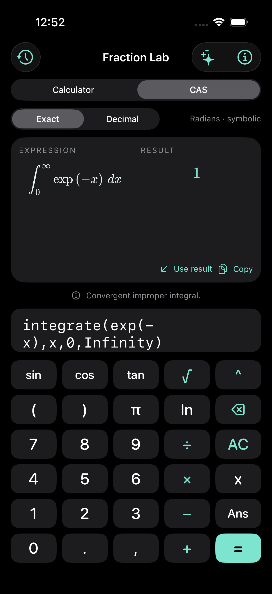
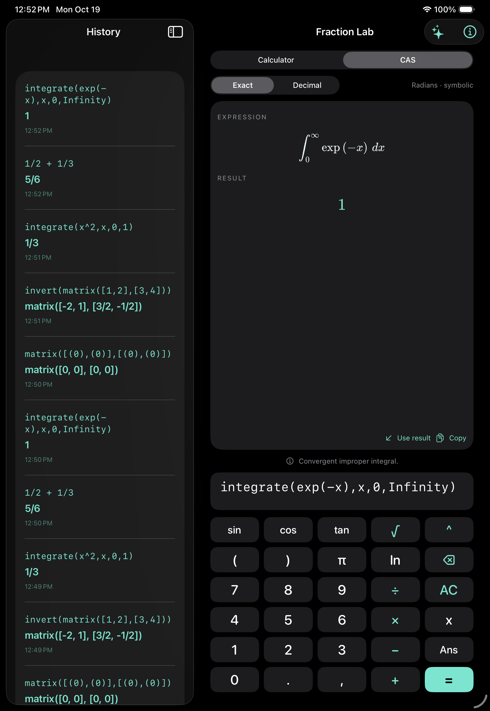
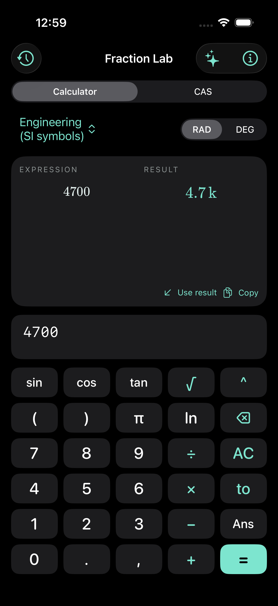
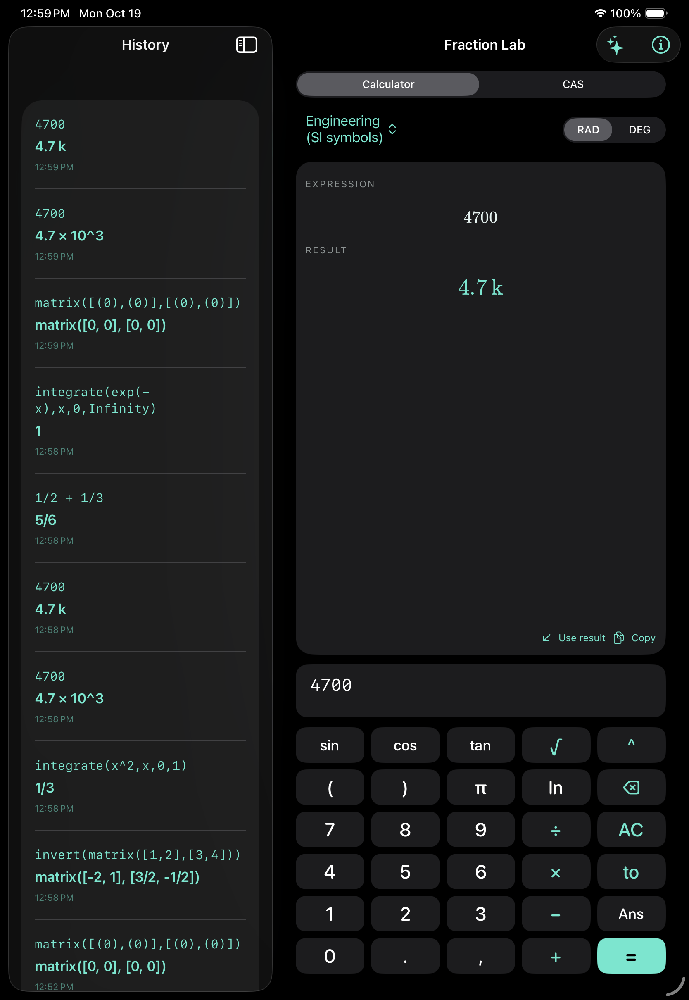

# Fraction Lab — offline calculator and CAS for iPhone and iPad

A SwiftUI calculator with stacked fractions, dark mode, history, a matrix-entry
grid, and an offline computer algebra system. **Calculator** mode uses the
original MIT-licensed Swift engine. **CAS** mode uses Nerdamer 2.0.0 (Apache-2.0)
with its embedded decimal.js 10.6.0 (MIT). KaTeX (MIT) renders equations.
No Qalculate, GMP, MPFR, or Qalculate datasets are included.

## Result notation

Choose **Result format** above the expression area. The selection applies to the
next calculation in both Calculator and CAS modes:

| Format | 4700 | 0.0000022 |
| --- | --- | --- |
| Exact | 4700 | 11/5000000 |
| Decimal | 4700 | 2.2 × 10⁻⁶ |
| Engineering | 4.7 × 10³ | 2.2 × 10⁻⁶ |
| Engineering (SI symbols) | 4.7 k | 2.2 µ |

Engineering exponents are multiples of three. SI symbols cover q (10⁻³⁰) through
Q (10³⁰), with engineering powers of ten outside that range. Symbols are display
scale factors, not new variables or an expansion of the unit parser. These modes
use decimal evaluation and format numeric coefficients, complex components, and
matrix entries; symbolic variables remain symbolic. Decimal shifting adds no
rounding beyond the engine's existing numeric precision.

Copy, Ans, and Use result retain the canonical numeric expression so a displayed
prefix cannot be mistaken for a variable or unit. History preserves the display
and restores the chosen notation when recalled. Existing history remains readable,
and the old Exact/Decimal preference migrates automatically.

## CAS mode

Select **CAS** above the expression area. It uses radians and interprets names as
symbols, not units. Use `*` explicitly between a symbol and parentheses.
All computations run locally in a fresh, terminable Web Worker. Nothing is sent
to a server; no runtime code downloads, API keys, Node installation, or CDN are
needed on the device.

| Operation | Example |
| --- | --- |
| Combine symbolic terms | `x+x` |
| Expand | `expand((x+1)^3)` |
| Factor | `factor(x^2-1)` |
| Simplify | `simplify((x^2-1)/(x-1))` |
| Substitute | `subst(x^2+1,x,3)` |
| Differentiate | `diff(sin(x^2),x)` |
| Symbolic antiderivative | `integrate(x^2*sin(x),x)` |
| Definite integral, exact when available | `integrate(x^2,x,0,1)` |
| Infinite interval → 1 | `integrate(exp(-x),x,0,Infinity)` |
| Singular endpoint → 2 | `integrate(1/sqrt(x),x,0,1)` |
| Interior singularity → 4 | `integrate(1/sqrt(abs(x)),x,-1,1)` |
| Numerical quadrature | `nint(exp(-x^2),x,0,1)` |
| Limit | `limit(sin(x)/x,x,0)` |
| Solve an equation | `solve(x^3-1,x)` |
| Solve a linear system | `linsolve([x+y=3,x-y=1],[x,y])` |
| Matrix | `matrix([1,2],[3,4])` |
| Matrix multiplication | `matrix([1,2],[3,4])*matrix([1,0],[0,1])` |
| Determinant | `determinant(matrix([1,2],[3,4]))` |
| Inverse | `invert(matrix([1,2],[3,4]))` |
| Transpose | `transpose(matrix([1,2],[3,4]))` |
| Row reduction | `rref(matrix([1,2,3],[2,4,6]))` |
| Rank | `rank(matrix([1,2],[2,4]))` |
| Identity | `imatrix(3)` |

The Examples menu includes a matrix-entry grid for up to **8 × 8** entries.
Matrix cells can contain fractions or symbols. Results can be copied or inserted
back into another expression. Matrix addition/subtraction, scalar multiplication,
and integer powers are also supported. Matrix `/` is element-wise division; use
multiplication by `invert(...)` for inverse multiplication.

CAS also exposes `sqrt sin cos tan asin acos atan sinh cosh tanh exp log log10
abs floor ceil numeric vector dot cross gcd lcm partfrac coeffs`. Here `log`
(and alias `ln`) means natural logarithm. `det`, `inv`, and `integral` alias
`determinant`, `invert`, and `integrate`. Decimal mode requests numeric evaluation;
symbolic terms remain symbolic. Exact CAS rational integers are not restricted
to the native engine's 64-bit range, but memory, input, output, and time limits
still apply. Numerical quadrature uses Double arithmetic.

### Integration and solver behavior

- An indefinite integral returns one antiderivative; **add an arbitrary C**.
  If no closed form is found, the integral remains visibly unevaluated and a
  warning explains that result.
- **Improper integrals** use a verified symbolic antiderivative and explicit
  one-sided limits. Infinite bounds accept `Infinity`, `inf`, or `∞`, with an
  optional minus sign. Interior singularities split the interval; every side
  must converge independently. Tap the information label below a result for its
  complete calculation notes. For example, `integrate(1/x,x,-1,1)` is divergent,
  even though its Cauchy principal value is zero. Reversed bounds negate the result.
- The original MIT analysis module certifies domain boundaries using linear and
  quadratic factors and strictly positive even polynomials, with polynomial
  analysis bounded to degree 16. It handles elementary endpoint limits,
  rational tails, logarithmic endpoints, and polynomial-times-exponential decay.
  It verifies antiderivatives by differentiation and does not use Nerdamer's
  general `limit` routine for convergence decisions. Absolute values are resolved
  separately on each component; restrictions are checked before simplification.
- **Divergent** means an analyzed one-sided primitive limit is infinite.
  **Convergence unresolved** means a required domain, antiderivative, or limit
  rule is unavailable; it does not mean the integral diverges. For example,
  `integrate(exp(-x^2),x,0,Infinity)` remains unresolved, despite its known value
  `sqrt(pi)/2`. No infinite-tail cutoff or numerical guess is substituted.
- Finite continuous real integrals use adaptive Simpson quadrature (absolute
  error target 1e-9). When an antiderivative is available, endpoint evaluation is
  cross-checked against the numerical result. Otherwise the answer is marked
  approximate. Screening and finite sampling are not universal proofs of
  continuity or error guarantees; unresolved domain analysis is rejected.
  `nint` uses the same convergence analysis for improper integrals and reports
  the convergent result numerically. It does not add general numerical improper
  integration capabilities.
- General `solve` may be incomplete. Partial or unresolved sets are flagged;
  candidates must satisfy the original equation. `linsolve` handles up to eight
  linear equations/variables. Its solution dictionaries are display/copy results,
  not scalar expressions for re-entry.
- Symbolic simplification and matrix pivoting can require domain assumptions.
  Preserve original restrictions and check special parameter values.
- `nint`, bounded `integrate`, `linsolve`, and `rank` are outermost operations.
  Other supported CAS functions can be nested. Arbitrary scripts, assignments,
  user function definitions, and network access are not exposed.

CAS limits: 4096 UTF-8 input bytes, 512 tokens, 32 nesting levels, 128-digit numeric
literals, explicit powers of magnitude at most 1000, matrix dimensions up to 8,
20,000 output text characters, 50,000 quadrature samples, and a **five-second
native deadline** including worker startup. Cancel is available during CAS work.
Each calculation has independent state; timeout/cancellation discards its worker.

## Calculator mode

The original Swift calculator remains available for degree-mode trigonometry
and dimension-checked units. It supports exact fractions within signed 64-bit
numerator/denominator limits; overflow becomes approximately 15-digit arithmetic
with an approximation indicator. Scientific functions, complex arithmetic,
elementary derivatives, and linear/quadratic solving remain available.

```text
1/2 + 1/3
0.1 + 0.2
5 ft + 3 in to cm
60 km/h to m/s
sqrt(-1)
```

Supported unit names (case-sensitive): `m cm mm km in ft yd mi kg g mg lb oz s ms
min h day K L mL Hz N Pa J W`. No Celsius/Fahrenheit offsets or live currency
rates. Calculator `ln` is natural log; `log` is base ten. Calculator expressions
have 256-token and 48-level nesting limits. Use CAS mode for matrices and integrals.

History keeps the last 100 results locally and remembers CAS mode when recalled.
Older history remains readable. Entry uses linear notation; results use textbook
notation. Graph plotting is not included.

## Build and run

Requirements: Apple Silicon Mac, Xcode with iOS SDK and Simulator runtime, and
Homebrew `xcodegen`. Deployment target: iOS/iPadOS 17+.

```sh
brew install xcodegen
Scripts/build-app.sh
open Qalculate.xcodeproj
```

Select scheme **Qalculate** and an iPhone/iPad simulator. The app's display name
is **Fraction Lab**; repository and build-target names remain for continuity.
The script cleans old products, builds simulator/device apps, and audits the
packaged device resources and dependencies. For a physical device, choose your
Apple development team under Signing & Capabilities and Run. No App Store or
TestFlight submission has been made.

`project.yml` generates the Xcode project. Bundled assets are committed, so
ordinary builds need no package downloads. Optional maintenance scripts verify
pinned archive hashes before refreshing dependencies:

```sh
Scripts/vendor-math.sh
python3 Scripts/vendor-cas.py
```

## Tests

```sh
xcodebuild -project Qalculate.xcodeproj -scheme Qalculate \
  -destination 'platform=iOS Simulator,name=iPhone 17 Pro' \
  -derivedDataPath .build/Tests CODE_SIGNING_ALLOWED=NO test
node Tests/cas-adapter.test.cjs
python3 Scripts/audit-distribution.py
```

Node is only needed for the extra adapter checks, not the app or Xcode tests.
See [validation](VALIDATION.md) and [dependency inventory](THIRD_PARTY.md).

## License

Original app/adapter code is MIT-licensed. Nerdamer is Apache-2.0; its embedded
decimal.js and KaTeX are MIT. Complete notices are bundled and accessible under
About → License notices. Historical GPL prototype commits retain their original
licenses; none of that engine or dataset code is in this version. This remains
an independent app, not an official Qalculate release.

## Preview

| Improper integral on iPhone | Improper integral on iPad |
| --- | --- |
|  |  |

| Engineering SI symbols on iPhone | Engineering SI symbols on iPad |
| --- | --- |
|  |  |

## Release preparation

Version 1.0.0 (build 6) materials are in [Release](Release/RELEASE-CHECKLIST.md):
listing copy, review notes, privacy/support pages, and native App Store screenshots.
Support contact: Boonmamccain@gmail.com. `Scripts/archive-release.sh` builds an
unsigned archive by default; configure `TEAM_ID` for signing. Distribution signing,
working public HTTPS pages, and App Store Connect setup are still required.

Build 9 keypad update groups scientific functions above the digits, puts AC
beside the upper-right delete key, and places EE beside 9. Division, multiplication
and subtraction run down the right edge; + and = sit together on the bottom row.
The conversion key is labeled Units (x in CAS mode). Commas are available through
the text keyboard. EE inserts numeric `e`, or `10^` at an empty operand.
The packaged build 6 archive predates these updates; regenerate it before release.
