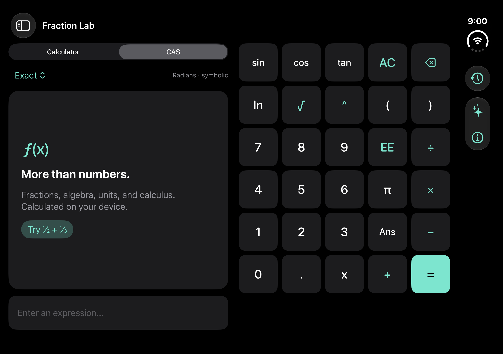

# iPhone Duo validation

Apple guidance: https://developer.apple.com/iphone-duo/prepare/

Build 12 uses Xcode 27.1 and the iOS 27.1 SDK for full-display support, while
retaining the iOS 17 minimum deployment target.

The calculator keeps one NavigationSplitView hierarchy across size changes.
The outer layout is fixed: only the expression editor and result panel scroll.
Wide windows show results/editor on the left and the complete keypad on the
right. Narrow windows stack them. Safe areas remain system-managed; keypad
buttons are at least 44 points high.

The unfolded Duo simulator passed the keypad bounds/hit-target test, and the
folded layout was visually inspected. Rotation-state and EE/delete regression
tests passed. Build 12 was installed and launched on the physical Duo.
See ../../VALIDATION.md for test scope and limitations.

Before distribution, additionally exercise narrow/wide multitasking, folding
while editing or running CAS, cursor selection, matrix sheets, keyboard dismissal,
and history. Regenerate the obsolete build 6 archive and store screenshots.
